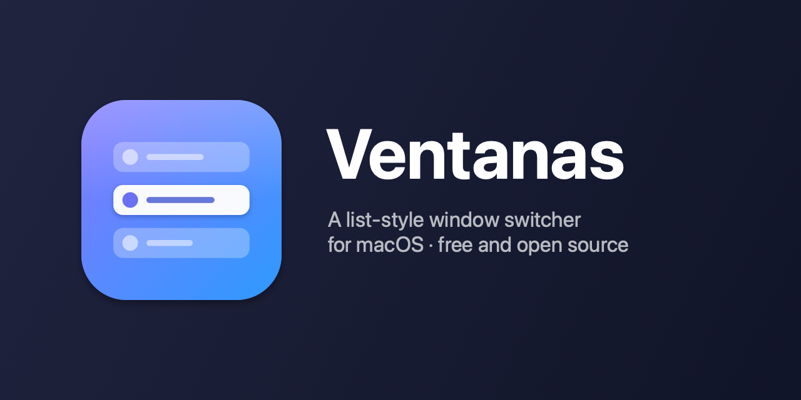

# Ventanas

**A free, open-source, list-style window switcher for macOS.**

*"Ventanas" is Spanish for "windows".*

Most free window switchers (like AltTab) show a thumbnail of every window. Ventanas takes another route: a
compact text list with the app icon and the window title, which is quicker to scan and easier on the eyes. It is
an open-source take on paid list-style switchers such as Contexts.

## Features

- **A list, not thumbnails**: icon, title and state (minimized, hidden, no windows) at a glance.
- **Window by window**, not app by app, ordered by recent use.
- **Search as you type**: with the panel open, type to filter by app or window title (case and accent insensitive).
- **Close windows and quit apps** without leaving the list, with a button on each row or from the keyboard.
- **Configurable key**: ⌘, ⌥ or ⌃ from the Settings window. With ⌘ it replaces the system ⌘Tab.
- Light and native (Swift + AppKit), no dependencies. Lives in the menu bar.

## Usage

| Shortcut | Action |
|---|---|
| `⌘Tab` | Opens the list with the next window selected (the key depends on your Settings) |
| `⌘⇧Tab` | Same, with the last window selected |
| `` ⌘` `` (`⌘º` or `⌘<` on a Spanish keyboard) | Only the current app's windows |
| `Tab` / `⇧Tab` / `↑` `↓` | Move through the list (it wraps around) |
| Release the modifier, or `Return` | Switch to the selected window |
| Type | Search; the list stays open until `Return` or `Esc` |
| `⌘⇧W` / `⌘⇧Q` | Close the selected window / quit its app (use your own modifier if you changed it) |
| `✕` / power button on a row | Close that window / quit that app (shown on the selected row and on the one under the mouse) |
| `Esc` | Cancel |
| Click a row / click outside | Switch to that window / cancel |

## Installation

Requires macOS 14 or later and the Command Line Tools (`xcode-select --install`).

    git clone https://github.com/juandiega/ventanas.git
    cd ventanas
    ./build.sh
    open build/Ventanas.app

The first time, macOS asks for **Accessibility** permission (System Settings → Privacy & Security).

To start it at login and relaunch it if it crashes:

    ./install.sh              # installs into ~/Applications + a LaunchAgent
    ./install.sh --uninstall  # removes everything

> **Compatibility:** developed and tested on macOS 27.0.1. Other versions are untested; if you try it, please
> open an issue and tell us how it went.

## Limitations

- Closing a window or quitting an app is fire and forget: if the app asks to save changes first, the row is
  already gone from the list and comes back the next time you open it. The Finder can't be quit from the list.
- It only lists windows of the current Space (plus minimized ones and those of hidden apps).
- The signature is ad-hoc: after rebuilding, macOS may ask for the Accessibility permission again.
- It uses private macOS APIs (`CGSSetSymbolicHotKeyEnabled`, `_SLPSSetFrontProcessWithOptions`,
  `SLPSPostEventRecordTo`, `_AXUIElementGetWindow`), like AltTab and other similar apps. That means it can't go
  on the App Store and a macOS update could break them. If something goes wrong and the native ⌘Tab doesn't come
  back, quit and reopen the app, or log out.

## Development

    swift run Checks

The switcher's logic (the session, window ordering and search) lives in `VentanasCore`, with no AppKit, and is
checked without Accessibility permission. It doesn't use XCTest because the Command Line Tools don't include
it: each check prints `ok` or `FAIL`, and the program exits with code 1 if any fails. The project's vocabulary
is in [CONTEXT.md](CONTEXT.md).

## Icon

The icon is generated with code:

    swift tools/make-icon.swift && iconutil -c icns Resources/Ventanas.iconset -o Resources/Ventanas.icns

(the script leaves the `.iconset` in `Resources/`; delete it afterwards).

## License

[MIT](LICENSE)
